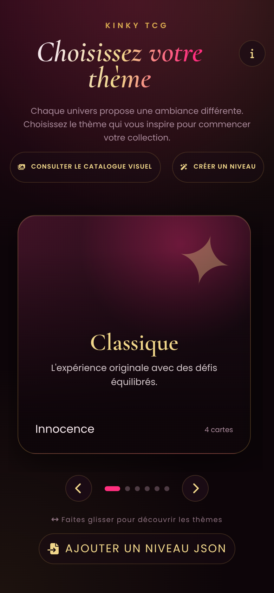
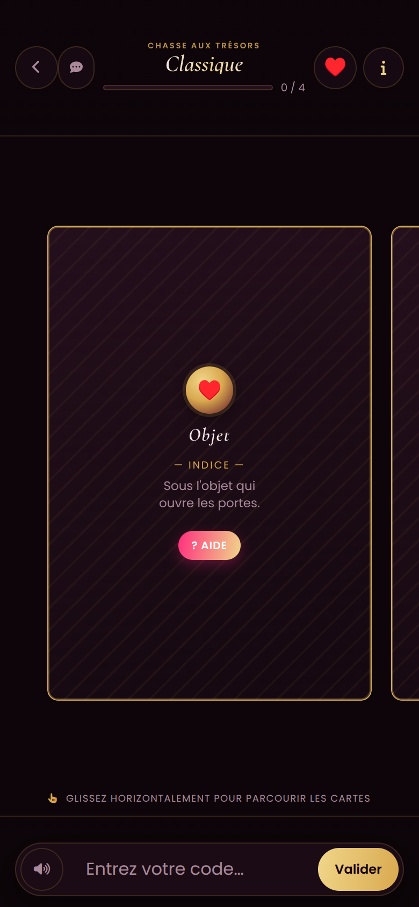
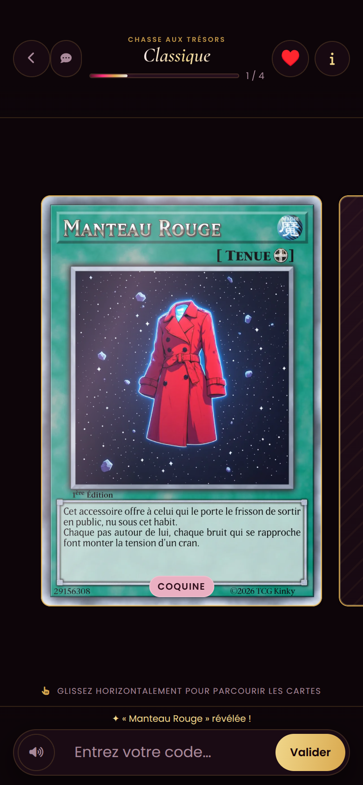

# 🎴 Kinky TCG

<div align="center">

**Un jeu d'énigmes et de cartes, basé sur le thème du kink et de l'érotisme.**

*Un maître du jeu crée un thème. L'autre résout les énigmes pour débloquer les cartes.*


🎮 **[Jouer](https://kinky-tcg.vercel.app)** · 💻 **[Voir le code](https://github.com/LaserOnWood/kinky-tcg)** · 🐛 **[Signaler un problème](https://github.com/LaserOnWood/kinky-tcg/issues)**

</div>

> 🔞 **Contenu réservé aux adultes (18 ans et plus).** Kinky TCG est un jeu conçu pour les couples. Il aborde la sensualité et l'érotisme, et ses cartes proposent des gages et des mises en situation à caractère adulte. En continuant, vous confirmez être majeur·e et jouer avec un·e partenaire consentant·e.

## 📚 Sommaire

- [🎯 Le concept](#-le-concept)
- [🕹️ Comment se déroule une partie](#️-comment-se-déroule-une-partie)
- [✨ Fonctionnalités](#-fonctionnalités)
- [🎭 Les thèmes](#-les-thèmes)
- [🛠️ Créer son propre thème](#️-créer-son-propre-thème)
- [🖼️ Le catalogue visuel](#️-le-catalogue-visuel)
- [📴 Hors ligne et installation](#-hors-ligne-et-installation)
- [🔔 Notifications Discord et retours](#-notifications-discord-et-retours)
- [🚀 Lancer le jeu en local](#-lancer-le-jeu-en-local)
- [🗂️ Structure du projet](#️-structure-du-projet)
- [🧰 Outils de maintenance](#-outils-de-maintenance)
- [☁️ Déploiement](#️-déploiement)
- [🧱 Technologies](#-technologies)
- [🗺️ Prochaines étapes](#️-prochaines-étapes)
- [🤝 Contribuer](#-contribuer)
- [🎨 Crédits](#-crédits)
- [📜 Licence](#-licence)


## 📸 Aperçu
<center>
  <table align="center">
    <tr>
      <td></td>
      <td></td>
      <td></td>
    </tr>
    <tr align="center">
      <td>Choix du thème</td>
      <td>Carte verrouillé et son indice</td>
      <td>Carte révélé</td>
    </tr>
  </table>
</center>

## 🎯 Le concept

Kinky TCG transforme un moment à deux en **chasse aux énigmes**. Chaque carte est cachée derrière un mot de passe. Pour le trouver, il faut réfléchir aux indices et fouiller son environnement. Quand le bon mot est saisi, la carte se retourne, dévoile son illustration et propose une **action à réaliser**.

Deux rôles :

| Rôle | Ce qu'il fait |
|---|---|
| 🎩 **Le maître du jeu** | Crée un thème : ambiance, cartes, énigmes et mots de passe. Il prépare la partie pour l'autre. |
| 🎯 **La personne cible** | Résout les énigmes pour débloquer les cartes, puis réalise les actions qu'elles proposent, sauf si la description d'une carte indique autre chose. |

## 🕹️ Comment se déroule une partie

1. 🎩 Le maître du jeu prépare un **thème** (ou choisit un des thèmes existants).
2. 🎯 La personne cible ouvre le jeu et **choisit le thème** dans le carrousel.
3. 🃏 Chaque carte verrouillée affiche son **type** et un **indice**. Les indices peuvent renvoyer à des objets ou à des lieux du quotidien.
4. 🔑 Elle **saisit le mot de passe** dans la barre du bas, puis appuie sur **Valider**.
5. 💡 Bloquée ? Le bouton **Aide** dévoile l'indice suivant, quand la carte en propose plusieurs.
6. ✨ Bonne réponse : la carte **se retourne** et révèle son illustration. Elle peut s'ouvrir en grand d'un simple toucher.
7. 🏁 La jauge de progression se remplit. Le thème est terminé quand toutes les cartes sont révélées.

## ✨ Fonctionnalités

| | Fonctionnalité | Description |
|---|---|---|
| 🎭 | **Thèmes** | Plusieurs ambiances, chacune avec sa difficulté et son sceau. |
| 🃏 | **Cartes à révéler** | Un type, un ou plusieurs indices, une rareté et une illustration par carte. |
| 🔄 | **Révélation animée** | Retournement 3D de la carte et effet holographique sur les illustrations. |
| 💡 | **Aide progressive** | Plusieurs indices par carte, du plus discret au plus explicite. |
| 💾 | **Progression conservée** | Cartes révélées et indices consultés restent dans le navigateur, thème par thème. |
| 🔐 | **Mots de passe protégés** | Seules les empreintes SHA-256 sont dans les données, jamais les mots en clair. |
| 🔊 | **Sons** | Effets pour les bonnes et mauvaises réponses, avec un bouton pour les couper. Quelques surprises sont cachées. |
| 🛠️ | **Atelier de niveaux** | Un outil pour créer, exporter et importer ses propres thèmes. |
| 🖼️ | **Catalogue visuel** | La page `gallery.html` liste toutes les illustrations, avec recherche, filtres et zoom. |
| 📴 | **Hors ligne** | Installable sur l'écran d'accueil et jouable sans réseau après une première visite. |
| 🔔 | **Notifications Discord** | Optionnelles : un message peut être envoyé à chaque carte révélée. |
| 💬 | **Retours anonymes** | Une popup dans le jeu et la page `feedback.html` permettent d'envoyer un avis sans compte ni adresse e-mail. |
| 📱 | **Mobile d'abord** | Pensé pour le téléphone, confortable aussi sur tablette et ordinateur. |

## 🎭 Les thèmes

| Thème | Difficulté | En quelques mots |
|---|---|---|
| 🌸 **Classique** | Innocence | L'expérience originale, avec des défis équilibrés. |
| 🍃 **Zen & Douceur** | Innocence | Un moment de détente absolue et de connexion. |
| 🌙 **Aventure nocturne** | Transgression | Pour ceux qui aiment le mystère et l'exploration. |
| 🎂 **Anniversaire spécial** | Perversion | Fêter un anniversaire de façon exceptionnelle et le graver dans les mémoires. |
| 🎃 **Halloween** | Perversion | Fêter Halloween de façon exceptionnelle, avec des gages qui font frissonner. |
| 🎄 **Noël** | Perversion | Faire la fête de façon exceptionnelle et garder un souvenir inoubliable. |
| 🥵 **Sortie surprise** | Corruption | Une parenthèse impromptue qui sort de l'ordinaire, avec la touche de perversité habituelle. |
| 🌳 **Sortie nocturne au parc** | Dépravation | Une petite sortie nocturne au parc ? |

### 🌶️ Les cinq niveaux de difficulté

| Niveau | Ambiance |
|---|---|
| Innocence | Le frisson du premier regard. |
| Transgression | L'interdit devient stimulant. |
| Perversion | Les pudeurs tombent, les rôles s'affirment. |
| Corruption | Les limites morales sont franchies. |
| Dépravation | Le lâcher-prise le plus total. |

### 🎲 Le niveau Hasard

Le thème officiel **Hasard** propose une carte tirée au hasard dans chaque dossier de `assets/cartes/` : Actions, Lieu, Accessoires, Positions, Rituel et Tenue. Le bouton **Shuffle** d'une catégorie renouvelle uniquement sa carte ; les autres tirages restent inchangés. Touchez une illustration pour l'agrandir.

Les cartes affichées sont alimentées par `assets/cartes/index.json`, généré à partir des dossiers d'images. Après l'ajout, le retrait ou le déplacement d'une illustration, régénérez l'inventaire avec `npm run gallery:index`. Les nouveaux dossiers deviennent ainsi des catégories de tirage sans qu'il soit nécessaire d'ajouter leurs images une à une dans un fichier de thème.

La logique propre à ce mode — chargement et regroupement du catalogue, tirages, rendu des cartes et boutons **Shuffle** — est isolée dans `js/hasard.js`. `js/passemot.js` garde l'orchestration générale du jeu et du changement de thème.

### 💎 Les six raretés

Elles indiquent le caractère exceptionnel d'une carte, pas la difficulté de son mot de passe :

`Coquine` · `Provocante` · `Audacieuse` · `Envoûtante` · `Sulfureuse` · `Mythique`

## 🛠️ Créer son propre thème

### 🧙 Avec l'atelier de niveaux

Ouvrez `level-builder.html` (bouton **Créer un niveau** sur l'écran d'accueil). Vous y définissez le thème (nom, description, difficulté, sceau) puis ses cartes (titre, type, réponse, indices, image, rareté). Les réponses sont transformées en empreintes SHA-256 automatiquement. Le thème s'exporte en JSON par téléchargement ou par copie.

Sur l'écran d'accueil, le bouton **Ajouter un niveau JSON** importe un thème sur l'appareil, sans toucher au code.

### 📝 À la main, dans `json/themes/`

Les thèmes officiels sont répartis en deux niveaux :

- `json/themes.json` : **l'index**, qui liste les thèmes dans l'ordre d'affichage ;
- `json/themes/<id>.json` : **un fichier par thème**, avec ses cartes.

Chaque entrée de l'index décrit un thème :

```json
{
  "id": "classique",
  "name": "Classique",
  "description": "Un fil conducteur simple pour découvrir le jeu.",
  "difficulty": "Innocence",
  "seal": "♥️",
  "mode": "classique",
  "file": "themes/classique.json",
  "cardCount": 4
}
```

| Champ | Rôle |
|---|---|
| `id` | Identifiant unique du thème : il doit être le même dans l'index et dans son fichier. |
| `name`, `description` | Textes affichés sur l'écran de choix. |
| `difficulty` | Un des cinq niveaux : `Innocence`, `Transgression`, `Perversion`, `Corruption` ou `Dépravation`. |
| `seal` | Symbole affiché au dos des cartes (facultatif). |
| `mode` | `classique` (cartes à débloquer) ou `hasard` (voir plus haut). |
| `file` | Chemin du fichier du thème, **dans `json/themes/`** : `themes/<id>.json`. |
| `cardCount` | Nombre de cartes du thème, à tenir à jour quand vous en ajoutez. |

Le fichier du thème contient ses cartes :

```json
{
  "id": "classique",
  "mode": "classique",
  "cards": [
    {
      "id": 101,
      "type": "Action",
      "passwordHash": "… 64 caractères hexadécimaux (SHA-256) …",
      "hints": ["Premier indice", "Second indice, plus précis"],
      "title": "Le Prélude",
      "image": "assets/cartes/Actions/Mon_image.webp",
      "description": "Le gage ou le privilège de la carte.",
      "actions": "Texte de l'action à réaliser (facultatif).",
      "rarity": "Coquine"
    }
  ]
}
```

| Champ d'une carte | Contenu |
|---|---|
| `id` | Numéro unique dans le thème. |
| `type` | Catégorie de la carte (Action, Lieu, Accessoire…). |
| `passwordHash` | Empreinte SHA-256 du mot de passe, **jamais le mot de passe lui-même**. |
| `hints` | Un ou plusieurs indices ; le bouton « ? Aide » les fait défiler. |
| `title`, `description` | Titre et texte de la carte révélée. |
| `actions` | Action à réaliser, affichée dans la notification (facultatif). |
| `image` | Chemin relatif d'une image (ex. `assets/cartes/…`) ou adresse complète. |
| `rarity` | `Coquine`, `Provocante`, `Audacieuse`, `Envoûtante`, `Sulfureuse` ou `Mythique`. |

Pour fabriquer l'empreinte d'un mot de passe, ouvrez le jeu, puis la console du navigateur : `await genererHash("mon mot de passe")`. Les accents, les majuscules et les espaces autour sont ignorés à la saisie.

**Ajouter un thème** : créez `json/themes/<id>.json`, puis ajoutez son entrée dans `json/themes.json`. Le jeu vérifie l'index et chaque carte au chargement et signale la première erreur trouvée. L'ancien format, un seul fichier `json/cartes.json`, est encore lu en repli s'il existe.

## 🖼️ Le catalogue visuel

`gallery.html` réunit toutes les illustrations de `assets/cartes/` : recherche, filtres par catégorie, zoom. Pratique pour le maître du jeu qui compose un thème. ⚠️ Cette page **dévoile toutes les illustrations** : à ne pas ouvrir devant la personne cible.

## 📴 Hors ligne et installation

Un manifeste (`manifest.webmanifest`) et un service worker (`sw.js`) rendent le jeu installable sur l'écran d'accueil et utilisable sans connexion, par exemple pour un thème qui se joue en extérieur.

- Dès la première visite en ligne, les fichiers du jeu, les polices, les icônes et les données de tous les thèmes sont mémorisés. Les illustrations d'un thème sont téléchargées quand on l'ouvre (sauf si l'économiseur de données du téléphone est activé), puis au fil des cartes affichées.
- Les fichiers du jeu sont récupérés en priorité sur le réseau : une mise à jour publiée s'affiche dès qu'il y a une connexion. Si le réseau met plus de 4 secondes à répondre, la copie mémorisée est utilisée.
- Hors ligne, les notifications Discord ne sont pas envoyées, et les sons ne fonctionnent pas : ils ne sont pas mémorisés.

## 🔔 Notifications Discord et retours

Deux fonctions serveur (`api/notification.js` et `api/feedback.js`) relaient les messages vers Discord. Les adresses de webhook restent côté serveur, dans les variables d'environnement, et ne sont jamais dans le code :

| Variable | Rôle |
|---|---|
| `DISCORD_NOTIFICATION_WEBHOOK_URL_1`, `_2`, … | Une ou plusieurs adresses recevant une notification à chaque carte révélée. **Aucun mot de passe n'y est inclus.** |
| `FEEDBACK_DISCORD_WEBHOOK_URL` | Adresse recevant les retours anonymes. |

Le fichier `.env.example` montre le format. Ne commitez jamais un vrai fichier `.env`.

Sans configuration, le jeu fonctionne normalement : l'envoi échoue en silence et ne bloque jamais le déblocage d'une carte.

> 👀 **À savoir pour les joueurs :** une notification contient le nom de la carte, sa rareté, le thème et la difficulté, l'action à réaliser et l'illustration de la carte. **Le mot de passe saisi n'est jamais transmis** : il est vérifié localement, côté navigateur, avant tout envoi.

Sur Vercel, le serveur retrouve la carte dans les thèmes officiels (nom du thème et numéro de carte) et construit le message avec ces données, jamais avec celles envoyées par le navigateur. Une carte absente des thèmes officiels (niveau importé par un joueur) est envoyée en gris, marquée « non vérifiée ». Comme aucun mot de passe n'est transmis, le serveur ne peut pas prouver qu'une carte a vraiment été débloquée : il limite donc les envois par adresse (voir `lib/limites.js`) et abandonne une requête Discord qui ne répond pas au bout de 8 secondes. Sur un hébergement statique (GitHub Pages, FTP), le jeu reste jouable, mais sans notifications ni retours : le lien public « Jouer » est hébergé sur Vercel et dispose, lui, de ces fonctions.

Le bouton **Feedback** dans une partie conserve sa popup. La page `feedback.html` propose le même formulaire dans une vue dédiée, accessible depuis l'accueil, depuis la popup et depuis le raccourci de l'application installée. Pour le motif **Proposition de niveau**, le formulaire demande un export JSON du level-builder (512 Ko maximum). L’API vérifie le schéma et les cartes avant de joindre le fichier au message Discord ; elle ne l’importe pas automatiquement dans le jeu.

### Tester les notifications sans Vercel

Le dépôt fournit aussi un serveur local Node.js qui sert le jeu et expose localement le même endpoint `/api/notification`. Il lit un webhook Discord depuis un fichier local ignoré par Git :

```bash
cp discord-webhook.txt.example .discord-webhook.txt
# Remplacez l'URL dans .discord-webhook.txt par votre webhook Discord réel.
npm run dev:local
```

Ouvrez ensuite <http://127.0.0.1:8000>. Le fichier `.discord-webhook.txt` doit contenir une URL `https://discord.com/api/webhooks/...`, une seule URL active par ligne ; les lignes commençant par `#` sont ignorées. **Ne commitez jamais ce fichier et ne partagez jamais son contenu.**

Les notifications passent par **le même code que la production** (`api/notification.js`) : les cartes sont reconnues d'après les thèmes officiels (`json/themes.json` et `json/themes/`), une même carte n'est notifiée qu'une fois par 30 secondes et par adresse, et les cartes d'un niveau importé arrivent en gris, marquées « non vérifiées ». Le serveur local recharge ce code et les fichiers de thèmes automatiquement quand ils changent, et affiche dans la console la réponse de l'API à chaque notification (par exemple `HTTP 202` pour un doublon).

Le serveur local ne remplace pas Vercel : il sert uniquement aux tests locaux. Pour tester le déploiement Vercel et les deux fonctions serveur avec les variables d’environnement, utilisez toujours :

```bash
vercel dev
```

## 🚀 Lancer le jeu en local

Les cartes sont chargées avec `fetch` : il faut passer par un serveur HTTP local plutôt que d'ouvrir `index.html` directement.

```bash
python3 -m http.server 8000
```

Ouvrez ensuite <http://localhost:8000>. Pour tester aussi les notifications et les retours, utilisez la [CLI Vercel](https://vercel.com/docs/cli) (`vercel dev`).

## 🗂️ Structure du projet

```text
kinky-tcg/
├── index.html             # Le jeu
├── gallery.html           # Catalogue visuel des illustrations
├── level-builder.html     # Atelier de niveaux
├── feedback.html          # Page de retours (même formulaire que la popup)
├── manifest.webmanifest   # Installation sur l'écran d'accueil
├── sw.js                  # Service worker (mode hors ligne)
├── package.json           # Commandes de maintenance (npm run …)
├── vercel.json            # Fichiers inclus dans les fonctions serveur
├── api/
│   ├── notification.js    # Notification Discord à chaque carte révélée
│   └── feedback.js        # Retours anonymes vers Discord
├── lib/
│   └── limites.js         # Limitation des envois, partagée par les deux fonctions
├── js/
│   ├── utils.js           # Outils partagés (échappement HTML, SHA-256, fenêtres modales)
│   ├── passemot.js        # Moteur du jeu
│   ├── hasard.js          # Niveau Hasard
│   ├── carousel.js        # Carrousel des thèmes
│   ├── audio.js           # Sons
│   ├── notification.js    # Envoi des notifications
│   ├── feedback.js        # Popup de retours
│   ├── hasheur.js         # Générateur d'empreintes (console)
│   ├── gallery.js         # Catalogue visuel
│   └── level-builder.js   # Atelier de niveaux
├── css/
│   ├── base.css           # Socle minimal : remise à zéro, .btn, .alert, utilitaires
│   ├── main.css           # Styles du jeu
│   ├── icons.css          # Icônes SVG (Bootstrap Icons)
│   ├── feedback.css       # Popup de retours
│   ├── feedback-page.css  # Page de retours
│   ├── gallery.css        # Catalogue visuel
│   ├── level-builder.css  # Atelier de niveaux
│   └── vendor/            # Polices et licences tierces (voir LISEZMOI.txt)
├── json/
│   ├── themes.json        # Index des thèmes
│   ├── themes/            # Un fichier par thème (cartes, indices, empreintes)
│   └── gallery.json       # Inventaire du catalogue visuel
├── assets/
│   ├── cartes/            # Illustrations WebP et index.json (catalogue)
│   ├── audio/             # Sons
│   ├── ico/               # Icônes de l'application
│   └── icons/             # Icônes des raccourcis
├── docs/screenshots/      # Captures d'écran de ce README
├── scripts/               # Outils de maintenance et serveur local
├── discord-webhook.txt.example  # Modèle de webhook pour les tests locaux
├── .env.example           # Modèle des variables d'environnement
├── .github/workflows/     # Déploiements et optimisation des images
└── LICENSE
```

## 🧰 Outils de maintenance

| Commande | Rôle |
|---|---|
| `npm run gallery:index` | Régénère `json/gallery.json` et `assets/cartes/index.json` à partir de `assets/cartes/`. |
| `npm run gallery:watch` | Régénère l'inventaire à chaque changement dans `assets/cartes/`. |
| `node scripts/optimize-images.mjs` | **Simulation** : liste ce que l'optimisation des images ferait, sans rien modifier. |
| `node scripts/optimize-images.mjs --apply` | Redimensionne les images à 820 px de large maximum et les convertit en WebP. Un `.png` ou `.jpg` est remplacé par son `.webp` : **pensez à mettre à jour le chemin `image` dans le fichier du thème**. Nécessite `npm install sharp`. |

L'optimisation existe aussi comme workflow GitHub : onglet **Actions**, « Optimiser les images », **Run workflow**. Sans case cochée, c'est une simulation ; en cochant la case, les images sont modifiées et le résultat est enregistré dans `main`.

## ☁️ Déploiement

Le dépôt `LaserOnWood/kinky-tcg` est la source unique du projet. Chaque push sur `main` publie le jeu :

| Destination | Fonctionnement |
|---|---|
| ▲ **Vercel** | Hébergement complet avec fonctions serveur (notifications, retours). **C'est la version recommandée pour jouer.** Se met à jour à chaque push. |
| 🐙 **GitHub Pages** | Miroir statique du jeu dans `game/tcgproto` du dépôt `LaserOnWood.github.io`. **Sans notifications ni retours** : pratique pour consulter le code, pas pour une partie complète. |
| 📡 **Hébergement FTP** | Envoi des fichiers par FTP. Sans fonctions serveur, donc sans notifications ni retours. |

Un commit fait par un workflow ne déclenche pas les autres workflows : après « Optimiser les images », lancez « Synchroniser avec le site principal » à la main.

Les chemins du jeu doivent rester **relatifs** (`css/main.css`, `js/passemot.js`), car il est aussi publié dans un sous-dossier. Évitez la balise `<base>`.

## 🧱 Technologies

HTML, CSS et JavaScript natifs, sans étape de compilation : un petit socle CSS maison (`css/base.css`, dont les valeurs viennent de Bootstrap), des icônes [Bootstrap Icons](https://icons.getbootstrap.com/) intégrées en SVG (`css/icons.css`) et des polices Google Fonts ([Cormorant Garamond](https://fonts.google.com/specimen/Cormorant+Garamond) et [Poppins](https://fonts.google.com/specimen/Poppins)), le tout hébergé dans le projet (aucune dépendance externe, voir `css/vendor/LISEZMOI.txt`). L'API Web Crypto calcule les empreintes SHA-256. Node.js n'intervient que pour les outils de maintenance.

## 🗺️ Prochaines étapes

**Déjà en place** dans les dernières versions :

- [x] 📴 Mode hors ligne et installation sur l'écran d'accueil.
- [x] 🪶 Illustrations allégées (environ 80 % de poids en moins).
- [x] 🔄 Retournement 3D des cartes à chaque déblocage.
- [x] 🛠️ Atelier de niveaux et catalogue visuel.
- [x] 🔤 Réponses tolérantes : accents, majuscules et espaces ignorés.
- [x] 🔌 Aucune dépendance externe : socle CSS maison, icônes SVG et polices hébergées dans le projet.
- [x] 🗃️ Thèmes en fichiers séparés (`json/themes/`), avec un index.
- [x] 📱 Mode portrait sur téléphone : un écran invite à tourner l'appareil en paysage.

**Idées à l'étude** :

- [ ] 🔞 Écran d'avertissement 18+ à l'entrée du jeu.
- [ ] 💾 Export et import de la progression, pour changer d'appareil.
- [ ] 🎨 Thèmes finalisés : illustrations et mots de passe définitifs pour chacun.
- [ ] 🔒 Protection renforcée des mots de passe et du contenu des cartes.

## 🤝 Contribuer

Les contributions cohérentes avec l'esprit et l'architecture du jeu sont les bienvenues : corrections, améliorations d'accessibilité, traductions, nouveaux thèmes.

1. 💬 Ouvrez d'abord une **issue** pour les changements importants.
2. 🌿 Travaillez sur une branche dédiée.
3. ✅ Testez le parcours complet sur téléphone et ordinateur : choix du thème, déblocage d'une carte, progression, retour à l'accueil, et le jeu hors ligne si vous touchez à `sw.js`.
4. 🔀 Ouvrez une **pull request** qui décrit le problème et le comportement attendu.

Les illustrations proposées doivent être des créations fictives : **aucune image de personne réelle**.

## 🎨 Crédits

| | |
|---|---|
| 👤 **Concept, prompts et développement** | AzaSwitch |
| 🖼️ **Illustrations** | Générées avec **Stable Diffusion** à partir des prompts d'AzaSwitch, puis mises en forme avec un générateur de cartes. |
| 🔊 **Sons** | Récupérés sur [MyInstants](https://www.myinstants.com/fr/index/fr/). Les droits appartiennent à leurs ayants droit respectifs. |
| 🧩 **Socle, icônes et polices** | `css/base.css` (valeurs issues de Bootstrap), Bootstrap Icons, Cormorant Garamond, Poppins. |


## 📜 Licence

- 💻 **Code** (HTML, CSS, JavaScript, fonctions serveur, scripts, workflows) : licence **MIT**, voir le fichier [`LICENSE`](LICENSE).
- 🎴 **Contenus** (illustrations, textes et données des cartes, sons) : **non couverts par la licence MIT**. Tous droits réservés, hors éléments tiers listés dans les crédits. Ne les réutilisez pas sans l'accord de l'auteur.
